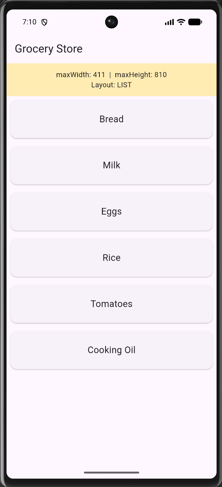

# LayoutBuilder Demo

LayoutBuilder is a widget that calls the builder function at layout time and provides the parent widget's constraints.

## Demo

## How to run
1. `git clone https://github.com/mackun-ui/layoutbuilder_demo.git`
2. Run `flutter pub get`
3. Start your emulator
4. Run `flutter run`

## Three attributes
1. **builder**: This is the function that gives you the context and constraints and returns a widget. In this project, it is the function that produces the banner and layout.
2. **constraints.maxWidth**: This is the value you compare against a breakpoint to switch layouts. In this project, `maxWidth` is the most horizontal space available. I compare it to 600 to decide between list and grid.
3. **constraints.maxHeight**: This shows how the available space changes with orientation or parent size. In this project, this changes when you rotate the Android emulator.

## Sources
- GeeksforGeeks, "Flutter - LayoutBuilder Widget": used as a reference for how LayoutBuilder and its constraints work. https://www.geeksforgeeks.org/flutter/flutter-layoutbuilder-widget/ 